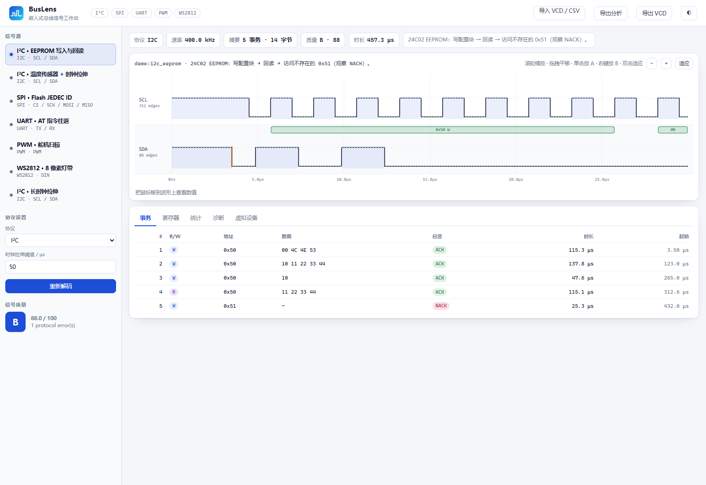
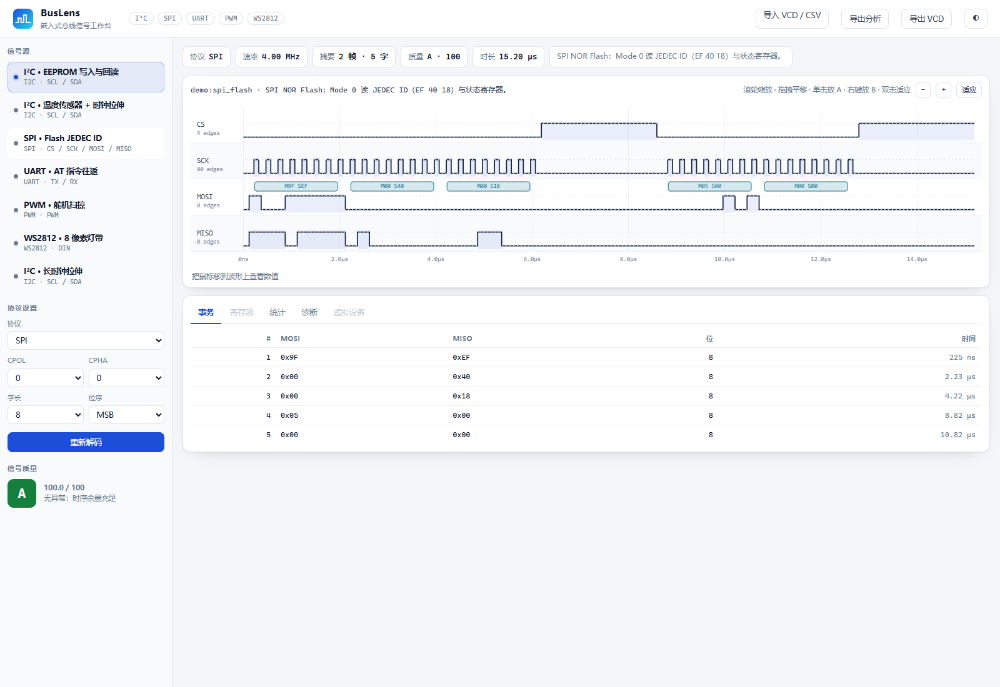
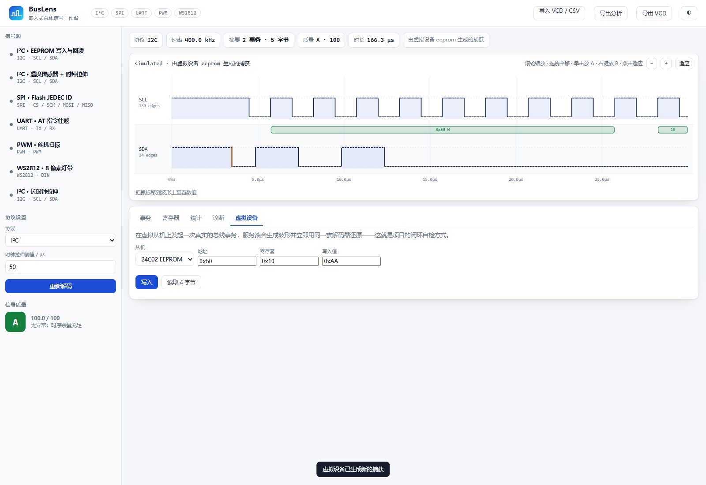

# BusLens · 嵌入式总线信号工作台

<p align="left">
  
  
  
  
  
  <a href="https://github.com/18971181532/buslens/actions/workflows/tests.yml">
    
  </a>
</p>

> 逻辑分析仪抓到的是一串 0/1。BusLens 把它变成**事务、寄存器和"这条总线还健康吗"的结论**，
> 并且能反过来用虚拟从机生成"已知正确"的波形，闭环验证解码器本身。
> 纯 Python 标准库实现，**零第三方依赖**，离线可用。



---

## 1. 项目简介

调单片机的人几乎每天都在和这几件事打交道：

- I²C 从机不应答，是地址错了、上拉不对，还是从机在时钟拉伸？
- SPI 读回来的 ID 是 `0xFFFFFF`，是模式配错（CPOL/CPHA），还是 MISO 没接？
- 串口打印乱码，波特率到底差了多少？
- 灯带颜色不对，是 GRB 顺序，还是 T0H/T1H 落到了判决门限附近？

示波器能看波形但不会告诉你"这是 0x50 的写事务、第三个字节没被 ACK"；商业协议分析仪好用但贵；
PulseView 需要装驱动、跑桌面环境，而且**解码结果和设备语义是分离的**。

BusLens 的定位是这条链路的"最后一公里"：

| 输入 | 处理 | 输出 |
| --- | --- | --- |
| VCD / CSV 抓包、内置示例、虚拟设备仿真 | 边沿级协议解码 + 时序分析 | 事务表、寄存器视图、错误清单、质量评分、可缩放的波形 |

它同时是一个**可自检的工具**：编码器与解码器互为参照，45 个单元测试里有 30 多个是
"生成波形 → 解码 → 比对原始数据"的往返测试。工具本身的行为是被测试锁住的，而不是"看起来对"。

---

## 2. 核心功能

### 协议解码

| 协议 | 能力 |
| --- | --- |
| **I²C** | START / 重复起始 / STOP 条件检测；7 位与 10 位地址；ACK/NACK；时钟拉伸统计；事务分组；SDA 建立时间余量；**寄存器视图推断** |
| **SPI** | CPOL/CPHA 四种模式；CS 分帧；MSB/LSB 优先；MOSI 与 MISO 同时采样；字长可配 |
| **UART** | **自动波特率**（无需事先知道速率）；5–9 数据位；奇/偶校验；1/2 停止位；帧错误与校验错误定位；双通道（TX/RX）同时解码 |
| **PWM / 舵机** | 频率、占空比、高电平宽度、周期抖动、丢脉冲检测；自动区分舵机脉冲（50 Hz / 1–2 ms）与普通 PWM |
| **WS2812** | T0H/T1H 判决（门限可调）、GRB 像素还原、复位间隔分帧、模糊位告警 |

### 工作台

- **波形视图**：滚轮缩放、拖拽平移、A/B 游标与 Δt、双击适应；字节/字/像素注解直接画在波形上。
- **事务表**：I²C 事务（R/W、地址、数据、ACK、时长）、SPI 字、UART 帧、WS2812 像素色块。
- **寄存器视图**：按"首字节 = 寄存器指针"的通用约定重建寄存器表，并标注来源是写入还是读回。
- **诊断**：错误与警告按时间排序，点击可跳转到对应位置。
- **虚拟设备**：在 24C02 EEPROM / TMP102 传感器上发起真实的读写事务，服务端生成波形后**立即用同一套解码器还原**，闭环演示。
- **导入导出**：VCD / CSV 导入，VCD / JSON 导出。

### 命令行

同一套能力在终端可用，方便脚本化回归与批量分析。

<table>
<tr>
<td width="50%"></td>
<td width="50%"></td>
</tr>
<tr>
<td align="center"><sub>SPI 四线波形：CS 分帧、MOSI/MISO 同字对齐</sub></td>
<td align="center"><sub>虚拟设备：发起一次读取，生成波形后立即解码</sub></td>
</tr>
</table>

---

## 3. 技术方案

### 3.1 边沿驱动的解码，而不是固定采样率

逻辑分析仪存的是**跳变时间戳**，不是等间隔采样点。如果先降采样成固定速率再解码，
100 ns 的毛刺、时钟拉伸、建立时间余量都会丢失。BusLens 的 `DigitalSignal` 直接保存
`(t_ns, level)` 跳变序列：

```python
sig = DigitalSignal("SDA", [(3500, 0), (4500, 1)], initial=1)
sig.level_at(4000)     # 0，二分查找
sig.intervals(1)       # 高电平区间列表
```

解码器只在这个序列上工作，时间分辨率等于原始抓包分辨率。VCD 解析支持 `$timescale` 单位换算
（ns/µs/ms/s），CSV 支持表头（`t,SCL,SDA`）与单列 0/1 两种格式。

### 3.2 自动波特率：脉宽聚类 + 停止位合法率

"最短脉冲就是一个位"这条经验在载荷为 `0xFF` 或 `0x00` 时会失效。BusLens 分两步：

1. 取所有脉宽的 10% 分位数作为候选位宽，在 ±45% 邻域内聚类，取中位数；
2. 在该位宽的 ±5% 范围内做 25 点搜索，用**停止位合法的帧数**作为评分函数。

第二步是关键：即使位宽估计偏了 3%，只要停止位还落在正确的采样窗口里，帧依然能正确还原；
反之只要有一帧停止位为 0，就说明位宽偏了。实测在 4800–921600 baud、有校验位、
反相空闲电平的情况下都能一次锁定。

### 3.3 I²C：条件检测 + 事务状态机

I²C 没有"帧"的概念，只有条件：

- **START**：SCL 为高时 SDA 下降；**STOP**：SCL 为高时 SDA 上升；
- 其余时刻，数据在 **SCL 上升沿**采样。

所以解码器把两条线的跳变合并排序，按事件驱动状态机。合并顺序上 SDA 优先于 SCL
（同一时刻先处理数据变化，再处理时钟上升），这样 START/STOP 与采样点不会互相吞掉。

事务按 START…STOP 分组；重复起始会把上一条事务"截断"成一条独立记录——这正是
"写寄存器地址 → 重复起始 → 读数据"在波形上的真实形态：

```text
写 0x50 [0x10]        (指针)          ← 事务 3
读 0x50 [0x11 0x22]   (数据)          ← 事务 4
```

解码器还会区分"主设备主动 NACK"（读传输的正常结束）和"从设备 NACK"（地址不存在/写失败）——
前者不计入错误，后者会在诊断里明确报出。这个细节决定了工具是否可用。

### 3.4 虚拟设备：开漏线与 + 设备语义

`I2CSim` 不是简单地"画一个方波"，而是按 I²C 的电气语义生成波形：

- SDA 是开漏线与：**只要主设备或从设备任一方拉低，线就是低**；
- ACK 位由从设备决定，主设备在读传输的最后一字节主动 NACK；
- 从设备模型（24C02 的页写/顺序读、TMP102 的寄存器指针）决定数据内容；
- 可注入时钟拉伸（从设备拉低 SCL）与传输抖动。

这让"仿真 → 解码 → 寄存器视图"形成闭环：如果生成的是 `[0x10, 0xAA, 0xBB]`，
解码器还原出来的就必须是同一串字节；测试就是拿这个不变量做断言。

### 3.5 质量评分

`quality_score()` 把离散的错误折算成 0–100：

| 因素 | 扣分 |
| --- | --- |
| 协议错误（NACK 地址、帧错误、校验错） | 每次 12 |
| 警告（捕获在事务中间结束、STOP 位置异常） | 每次 3 |
| SDA 建立时间余量 < 8% 位宽 | 10 |
| 时钟拉伸 | 每次 1.5，上限 6 |
| PWM 周期抖动 > 1% | 抖动 × 2，上限 20 |
| 丢脉冲 | 每个 5，上限 15 |
| WS2812 判决门限附近的位 | 每比特 0.5，上限 10 |

分数不是装饰：它把"能不能用"变成可以排序、可以进 CI 的指标。

### 3.6 波形渲染

前端不依赖任何图表库，用 Canvas 手写：

- 跳变按像素坐标绘制阶梯线，高电平段填充半透明色带；
- 注解按时间跨度画成圆角矩形，宽度不足 14 px 时退化成竖线标记；
- 视图窗口（`t0, t1`）与物理时间解耦，缩放/平移只改窗口，不重算采样；
- 时间轴刻度用 1/2/5 × 10ⁿ 的"nice step"，自动切换 ns/µs/ms 单位。

---

## 4. 环境与依赖

- Python **3.9+**（仅标准库）
- 任意现代浏览器（Chrome / Edge / Firefox / Safari）
- 不需要 numpy / scipy / PyQt / 逻辑分析仪驱动

---

## 5. 安装与运行

```bash
git clone https://github.com/18971181532/buslens.git
cd buslens

# 方式 A：直接运行（无需安装）
python run.py demos

# 方式 B：可编辑安装，获得 buslens 命令
python -m pip install -e .
buslens --help
```

### 5.1 启动 Web 工作台

```bash
python run.py serve            # http://127.0.0.1:8777
python run.py serve --port 9000 --no-browser
```

打开后默认加载 I²C EEPROM 示例：左边是信号源与协议参数，中间是波形，下面是事务/寄存器/统计/诊断/虚拟设备五个面板。

### 5.2 命令行

```bash
python run.py demos                                   # 列出内置示例
python run.py decode --demo i2c_eeprom                # 解码并打印事务表
python run.py decode --demo spi_flash --json          # 输出完整 JSON
python run.py decode --vcd capture.vcd --protocol spi --cpol 0 --cpha 0
python run.py decode --csv samples.csv --protocol uart --baud 115200
python run.py export --demo uart_at --out uart.vcd    # 导出 VCD
python run.py simulate --plan examples/i2c_eeprom_plan.json \
    --device eeprom --clock 400000 --out cap.vcd      # 虚拟设备生成抓包
```

`--device` 可选 `eeprom` / `tmp102` / `none`（`none` 用来观察地址 NACK）。

---

## 6. 使用示例

### 6.1 I²C：写入、回读与地址 NACK

```text
$ python run.py decode --demo i2c_eeprom
I2C  400.0 kHz  ·  5 transaction(s)  ·  14 byte(s)  ·  quality B (88)
------------------------------------------------------------------------------
#   R/W  ADDR   DATA                         ACK         TIME
1   W    0x50   00 4C 4E 53                  ACK       115.2 us
2   W    0x50   10 11 22 33 44               ACK       137.8 us
3   W    0x50   10                           ACK        47.6 us
4   R    0x50   11 22 33 44                  ACK       115.1 us
5   W    0x51   —                            NACK       25.2 us
------------------------------------------------------------------------------
inferred register view:
  0x50[0x00] = 0x4C   (write)
  0x50[0x10] = 0x11   (write)
  0x50[0x11] = 0x22   (write)
  0x50[0x10] = 0x11   (read)
  ...
------------------------------------------------------------------------------
  ! NACK at byte 1                                       @ 454.2 us
```

第 5 条事务是故意访问不存在的 `0x51`，用来演示地址 NACK 的定位；
质量分从 100 掉到 88，诊断里给出精确时间戳。

### 6.2 SPI：读 JEDEC ID

```text
$ python run.py decode --demo spi_flash
SPI  4.00 MHz  ·  Mode 00  ·  2 frame(s)  ·  quality A (100)
------------------------------------------------------------------------------
frame 1  (6.2 us)
   #1   MOSI 0x9F   MISO 0xEF
   #2   MOSI 0x00   MISO 0x40
   #3   MOSI 0x00   MISO 0x18
frame 2  (4.2 us)
   #4   MOSI 0x05   MISO 0x00
   #5   MOSI 0x00   MISO 0x00
```

`EF 40 18` 是 Winbond W25Q 系列的 JEDEC ID 形态——工具把 MOSI 命令和 MISO 响应按
同一个字对齐，不用再对着手册一位一位数。

### 6.3 UART：自动波特率

```text
$ python run.py decode --demo uart_at
UART  115.2 kbaud  ·  26 frame(s)  ·  26 byte(s)  ·  quality A (100)
------------------------------------------------------------------------------
TX: 'AT+VER?\r\n'
RX: 'BusLens 1.0\r\nOK\r\n'
```

命令行没有传 `--baud`，速率是从波形里恢复的。

### 6.4 WS2812

```text
$ python run.py decode --demo ws2812
WS2812  800.0 kHz  ·  8 pixel(s)  ·  T0H 350 ns / T1H 700 ns
  frame 1: #FF0000 #FF4000 #FFA000 #80FF00 #00FF40 #0080FF #4000FF #FF0080
```

界面里会渲染成色块，并给出 T0H/T1H 的实测均值，方便判断灯带的时序是否在规格内。

### 6.5 导入真实抓包

从 Saleae Logic / PulseView 导出 VCD（`File → Export → VCD`），或整理成 CSV：

```csv
t_ns,SCL,SDA
0,1,1
3500,1,0
4500,0,0
...
```

在网页里点「导入 VCD / CSV」，或在命令行指定 `--vcd/--csv`。
通道名建议用 `SCL/SDA`、`SCK/MOSI/MISO/CS`、`TX/RX`、`DIN`，这样可以自动识别协议。

### 6.6 Python API

```python
import buslens as bl

# 1) 生成一段 I²C 抓包并解码
from buslens.devices import EEPROM24C02
from buslens.i2c import I2CSim

dev = EEPROM24C02()
cap = I2CSim(dev, clock_hz=400_000).run({"transactions": [
    {"type": "write", "address": 0x50, "data": [0x10, 0xAA, 0xBB]},
    {"type": "write_read", "address": 0x50, "data": [0x10], "count": 2},
]})
result = bl.analyze(cap, "i2c", {"scl": "SCL", "sda": "SDA"})
print(result["stats"]["clockHz"], result["decoded"]["transactions"][2]["bytes"])

# 2) 解码一段 UART 波形，速率未知
sig = bl.encode_uart(b"hello\r\n", 115200)
print(bl.decode_uart(sig)["text"])

# 3) 直接分析内置示例
print(bl.analyze(bl.build_demo("spi_flash")["capture"], "spi",
                 {"sck": "SCK", "mosi": "MOSI", "miso": "MISO", "cs": "CS"})["summary"])
```

---

## 7. HTTP API

| 方法 | 路径 | 说明 |
| --- | --- | --- |
| GET | `/api/health` | 版本、运行时长、示例数量 |
| GET | `/api/demos` | 内置示例列表 |
| POST | `/api/analyze` | `{demo}` / `{vcd}` / `{csv}` + `config`，返回完整分析 |
| POST | `/api/simulate` | `{device, clockHz, plan}`，生成波形并立即解码 |

```bash
curl -s http://127.0.0.1:8777/api/analyze -H 'Content-Type: application/json' \
  -d '{"demo":"i2c_eeprom"}' | python -m json.tool | head -30
```

---

## 8. 目录结构

```text
buslens/
├── run.py                     # 无安装启动入口（嵌入式 Python 友好）
├── pyproject.toml             # 打包与 buslens 命令
├── README.md
├── LICENSE                    # MIT
├── buslens/
│   ├── __init__.py            # 公共 API
│   ├── signal.py              # 跳变序列、二分查找、VCD/CSV 读写
│   ├── uart.py                # 自动波特率、帧解码、编码器
│   ├── i2c.py                 # 条件检测、事务状态机、开漏仿真
│   ├── spi.py                 # 四模式解码、CS 分帧、编码器
│   ├── pwm.py                 # PWM/舵机测量、WS2812 编解码
│   ├── devices.py             # 24C02 / AT24C32 / TMP102 虚拟从机
│   ├── analyze.py             # 统一分析入口、寄存器推断、质量评分
│   ├── demos.py               # 7 个可复现的内置抓包
│   ├── cli.py                 # 命令行
│   ├── server.py              # HTTP 服务与 JSON API
│   └── web/
│       ├── index.html         # 单页工作台
│       ├── style.css          # 明/暗双主题
│       └── app.js             # Canvas 波形 + 交互
├── examples/                  # 事务计划、VCD 示例
└── tests/                     # 45 个单元测试
```

数据流：

```text
VCD / CSV / demo / 仿真计划
        │
        ▼
   DigitalSignal（跳变序列）
        │  merge & sort
        ▼
   协议解码器 ──► 事务 / 字 / 帧 / 像素 ──► 注解（时间区间 + 标签）
        │                                        │
        ├──► 寄存器推断 ──► registerMap          ├──► Canvas 波形
        ├──► 质量评分 ────► grade / reasons      └──► 事务表
        └──► 统一 JSON ───► CLI / HTTP API
```

---

## 9. 测试

```bash
python -m unittest discover -s tests -t .
```

45 个测试，重点在**往返一致性**而不是"跑通不报错"：

1. **波形层**：跳变合并、二分查找边界、VCD 往返、`$timescale` 单位换算、CSV 两种格式。
2. **UART**：4 种波特率 × 3 种载荷的往返；自动波特率（含 4800 与 9600 低速率）；奇偶校验错、
   帧错误、反相空闲电平。
3. **I²C**：写/读/重复起始的事务切分；地址 NACK；时钟拉伸计数；寄存器推断；
   TMP102 的 12 位左对齐温度值。
4. **SPI**：4 种模式 × MSB/LSB 往返；双 CS 帧；注解内容。
5. **PWM/WS2812**：频率/占空比/舵机判定/丢脉冲；像素颜色、复位分帧、颜色注解。
6. **端到端**：7 个示例全部解码且注解结构与评分合法；错误会拉低评分；评级边界。
7. **CLI**：列举、人类可读输出、JSON 输出、VCD 导出、分析落盘。

---

## 10. 边界与已知限制

- **单主设备**：不做多主仲裁、时钟同步与 I²C 高速模式（Hs-mode）的电流源上拉切换。
- **不替代示波器**：只做数字时序与协议判断，不测上升时间、过冲、噪声容限。
- **SPI 仅按 CS 分帧**：没有 CS 的菊花链/连续时钟场景需要手动裁剪。
- **10 位 I²C 地址**解码已实现，但示例与虚拟设备只覆盖 7 位。
- **WS2812 判决门限**默认 550 ns，可用 `--threshold` 或界面调整；暂不自动学习门限。
- **VCD 只解析标量线**（`$var wire 1`），总线向量会被折叠成最低位。
- **寄存器视图是推断**：I²C 没有寄存器语义，"首字节 = 指针"是通用约定而非标准，
  界面与输出都标注了来源，避免误读。

---

## 11. 路线图

- [ ] CAN / LIN / 1-Wire / I²S 解码
- [ ] 采样率感知的毛刺过滤（按最小脉宽去噪）
- [ ] 与 sigrok 的 `.sr` 会话文件互通
- [ ] 自动协议识别（当前基于通道名与启发式）
- [ ] 串口实时读取逻辑分析仪（CH340/FT232 采样流）
- [ ] 把解码结果导出成 C 数组/CSV，便于直接塞进固件测试

---

## 12. 许可

MIT License，见 [LICENSE](LICENSE)。欢迎开 Issue 贴一段抓不到的波形，或直接提 PR 加协议。

> 本项目用于调试与教学；涉及安全关键系统时，请以数据手册的时序参数与实测电气特性为准。
